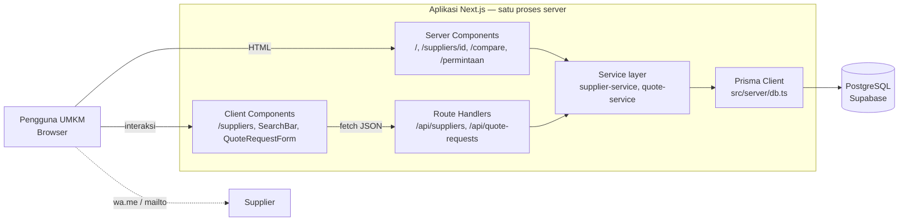
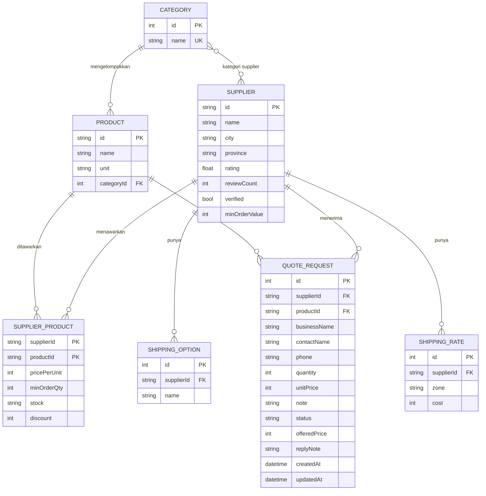
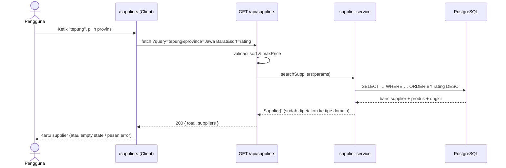
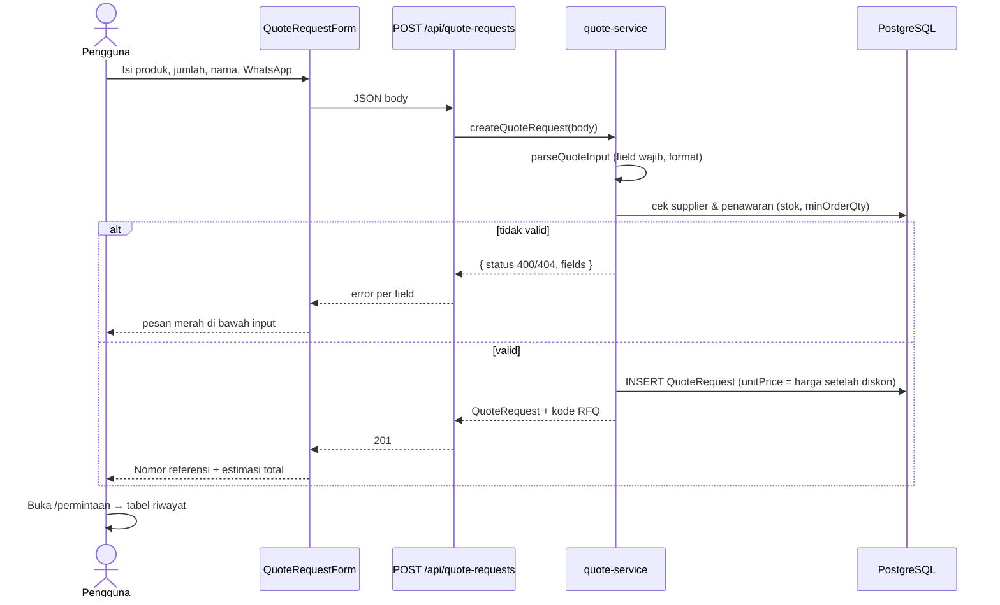

# Dokumen Arsitektur — SupplierHub (v1.0)

Platform pencarian, perbandingan, dan permintaan penawaran supplier bahan baku untuk UMKM.

## 1. Tujuan

Membantu pelaku UMKM menemukan supplier atau grosir bahan baku yang sesuai kebutuhan usaha, membandingkan
beberapa supplier berdasarkan harga, minimum order, stok, lokasi, dan reputasi, lalu mengirim permintaan
penawaran harga (RFQ) yang tersimpan di sistem.

MVP v1 adalah aplikasi **full-stack dalam satu proyek Next.js**: halaman UI dan REST API berjalan di server
yang sama, data disimpan di PostgreSQL (Supabase) lewat Prisma. Belum ada autentikasi; diasumsikan satu pengguna.

## 2. Stack Teknologi

| Lapisan        | Teknologi                                                   |
| -------------- | ----------------------------------------------------------- |
| Framework      | Next.js 16 (App Router)                                     |
| UI             | React 19, Tailwind CSS 4, lucide-react                      |
| Bahasa         | TypeScript 5                                                |
| API            | REST, Next.js Route Handlers (`src/app/api/**/route.ts`)    |
| ORM            | Prisma 7 (`prisma-client` generator + driver adapter)       |
| Database       | PostgreSQL (Supabase) via `@prisma/adapter-pg`              |
| Hosting        | Vercel (region `sin1`), deploy otomatis dari GitHub Actions |
| Testing        | Vitest (acceptance test terhadap database test terpisah)    |
| Integrasi luar | Tautan `wa.me` (WhatsApp) dan `mailto:`                     |

Riwayat: MVP awal memakai SQLite karena laptop pengembangan tidak punya Docker. Saat deploy ke Vercel (serverless,
filesystem tidak permanen) database dipindah ke PostgreSQL Supabase. Karena semua akses data lewat Prisma di
`src/server/`, perpindahan itu hanya mengubah `provider`, driver adapter, dan migrasi — halaman dan API tidak berubah.

## 3. Aturan Kode

* Semua label, tombol, pesan error, dan validasi menggunakan Bahasa Indonesia.
* PascalCase untuk komponen React, interface, dan type; camelCase untuk variabel dan fungsi;
  UPPER_SNAKE_CASE untuk konstanta global.
* Import memakai alias `@/` → `src/`.
* Tipe domain hanya didefinisikan sekali di `src/types/index.ts`. Frontend **tidak** mengimpor tipe Prisma.
* Service di `src/server/` memetakan baris Prisma ke tipe domain sebelum dikirim ke UI atau API.
* `"use client"` hanya untuk komponen yang butuh state/interaksi browser.
* Komentar hanya jika benar-benar perlu.

## 4. Gambaran Arsitektur



Lapisan:

1. **Presentation** — `src/app/**/page.tsx` dan `src/components/**`.
   * Server Component memanggil service secara langsung (tanpa HTTP) dan dirender per request (`await connection()`),
     sehingga tampilan selalu sesuai isi database.
   * Client Component memanggil REST API lewat `src/lib/api.ts`.
2. **API** — `src/app/api/**/route.ts`. Membaca parameter/body, memvalidasi, memanggil service,
   dan mengembalikan JSON dengan status HTTP yang sesuai (200/201/400/404).
3. **Service** — `src/server/supplier-service.ts`, `src/server/quote-service.ts`. Berisi query, aturan bisnis,
   dan mapping Prisma → tipe domain. Dipakai bersama oleh Server Component dan Route Handler.
4. **Data access** — `src/server/db.ts` membuat satu instance PrismaClient (disimpan di `globalThis` saat dev).
5. **Database** — skema di `prisma/schema.prisma`, riwayat perubahan di `prisma/migrations/`, data contoh di `prisma/seed.ts`.

### Strategi rendering

| Rute               | Jenis                         | Sumber data                                  |
| ------------------ | ----------------------------- | -------------------------------------------- |
| `/`                | Server Component, dinamis     | `searchSuppliers()`, `getProducts()`         |
| `/suppliers`       | Client Component              | `GET /api/suppliers` (setiap filter/sort berubah) |
| `/suppliers/[id]`  | Server Component, dinamis     | `getSupplierById()`; form RFQ → `POST /api/quote-requests` |
| `/compare`         | Server (data) + Client (interaksi) | `searchSuppliers()` → props `CompareClient`; pilihan di URL `?ids=` |
| `/permintaan`      | Server Component, dinamis     | `listQuoteRequests()`; filter lewat `?supplier=` |

## 5. Model Data



Catatan desain:

* `SupplierProduct` adalah tabel relasi Supplier ↔ Product dengan primary key gabungan (`supplierId`, `productId`):
  satu supplier hanya punya satu penawaran per produk.
* Daftar kategori, opsi kirim, dan ongkir per zona dinormalisasi ke tabel sendiri (relasional, mudah difilter lewat SQL).
* `QuoteRequest.unitPrice` adalah **snapshot** harga setelah diskon saat permintaan dibuat,
  supaya estimasi total tidak berubah jika supplier mengubah harga.
* `stock` bernilai `tersedia` | `terbatas` | `habis`; `status` RFQ: `BARU` | `DIBALAS` | `DITERIMA` | `DITOLAK` | `DIBATALKAN`.
* `QuoteRequest.offeredPrice` dan `replyNote` diisi saat supplier membalas.

Data contoh (seed): 8 kategori, 22 produk, 10 supplier.

## 6. REST API

| Method | Endpoint | Keterangan | Respons |
| ------ | -------- | ---------- | ------- |
| GET | `/api/suppliers?query=&category=&province=&maxPrice=&sort=` | Cari & filter supplier | 200 `{ total, suppliers }`, 400 parameter tidak valid |
| GET | `/api/suppliers/:id` | Detail supplier + produk | 200 `Supplier`, 404 |
| POST | `/api/quote-requests` | Buat permintaan penawaran | 201 `QuoteRequest`, 400 `{ error, fields }`, 404 supplier tidak ada |
| GET | `/api/quote-requests?supplierId=&status=` | Daftar permintaan, terbaru di atas | 200 `{ total, quotes }`, 400 status tidak dikenal |
| GET | `/api/quote-requests/:id` | Detail permintaan | 200 `QuoteRequest`, 404 |
| PATCH | `/api/quote-requests/:id` | Ubah status `{ status, offeredPrice?, replyNote? }` | 200, 400 data tidak valid, 404, 409 perpindahan status terlarang |

`sort`: `rating` (default) | `review` | `price_asc` | `price_desc` (berdasarkan minimum order supplier).

Contoh body `POST /api/quote-requests`:

```json
{
  "supplierId": "s10",
  "productId": "p01",
  "businessName": "Roti Bu Sari",
  "contactName": "Sari Wulandari",
  "phone": "081234567890",
  "quantity": 150,
  "note": "Kirim minggu depan"
}
```

## 7. Aturan Bisnis

**Pencarian (Fitur 1)**

* Kata kunci dicocokkan (tidak peka huruf besar/kecil) ke nama supplier, nama produk, atau kategori produk.
* Filter digabung dengan AND: kategori supplier, provinsi, dan harga maksimum per unit
  (lolos jika minimal satu produk ≤ harga maksimum). Filter kosong diabaikan.
* Semua filter dan urutan dikerjakan database (klausa `WHERE`/`ORDER BY` dari Prisma), bukan di browser.

**Perbandingan**

* Maksimal 3 supplier; ID duplikat atau tidak valid di URL diabaikan.
* Harga akhir = `pricePerUnit × (1 − discount/100)`.
* "Terbaik" per kriteria hanya ditandai jika minimal 2 supplier punya nilai dan nilainya tidak sama semua.

**Permintaan penawaran (Fitur 2)** — semua divalidasi di server:

| Aturan | Pesan |
| ------ | ----- |
| Produk wajib dipilih | "Pilih produk yang ingin ditanyakan." |
| Nama usaha & nama kontak 2–100 karakter | "Nama usaha wajib diisi (minimal 2 karakter)." |
| Nomor WhatsApp format Indonesia (`08…`, `628…`, `+628…`, spasi/strip dibuang) | "Nomor WhatsApp tidak valid. Contoh: 081234567890." |
| Jumlah bilangan bulat > 0 | "Jumlah harus bilangan bulat lebih dari 0." |
| Produk harus dijual supplier tersebut | "Produk ini tidak dijual oleh supplier tersebut." |
| Stok tidak boleh habis | "Stok … sedang habis." |
| Jumlah ≥ minimum order produk | "Minimum order … adalah … kg." |
| Catatan maks. 500 karakter | "Catatan maksimal 500 karakter." |

Nomor referensi: `RFQ-` + id 5 digit (contoh `RFQ-00001`). Estimasi total = `unitPrice × quantity`.

**Estimasi biaya (US3)** — `src/lib/cost-estimate.ts`

* Total = harga setelah diskon × jumlah + ongkir zona (tanpa zona = ambil sendiri, tanpa ongkir).
* Peringatan bila: jumlah < minimum order produk, subtotal < minimum belanja supplier, zona tidak dilayani, stok habis.

**Status RFQ (US5)** — `src/lib/quote-status.ts`

```text
BARU ──balas (harga wajib)──▶ DIBALAS ──▶ DITERIMA | DITOLAK
BARU / DIBALAS ──────────────▶ DIBATALKAN
```

`DITERIMA`, `DITOLAK`, `DIBATALKAN` adalah status akhir. Perpindahan lain ditolak 409.
Update memakai `WHERE id AND status = <status lama>` agar dua perubahan bersamaan tidak saling menimpa.

## 8. Alur Data

### Fitur 1 — mencari supplier



### Fitur 2 — mengirim permintaan penawaran



## 9. Struktur Folder & Alasannya

Prinsip: **folder dipisah berdasarkan lapisan (layer) dan tanggung jawab**, mengikuti alur
`Halaman → (API) → Service → Prisma → Database`. Setiap pertanyaan "kode X ada di mana?" punya satu jawaban,
dan aturan bisnis bisa diuji tanpa browser maupun database.

```text
Rpl-app/
├── src/
│   ├── app/                      ① ROUTING — 1 folder = 1 URL (konvensi App Router Next.js)
│   │   ├── page.tsx              /             Beranda
│   │   ├── suppliers/            /suppliers    Direktori + pencarian; [id]/ = detail + form RFQ
│   │   ├── compare/              /compare      page.tsx (ambil data, server) + CompareClient.tsx (interaksi)
│   │   ├── permintaan/           /permintaan   Riwayat & status RFQ
│   │   ├── api/                  REST API (Route Handlers)
│   │   │   ├── suppliers/        GET /api/suppliers, GET /api/suppliers/:id
│   │   │   ├── quote-requests/   GET/POST /api/quote-requests, GET/PATCH /api/quote-requests/:id
│   │   │   └── health/           GET /api/health (cek aplikasi & koneksi database)
│   │   └── layout.tsx, error.tsx, not-found.tsx, robots.ts, sitemap.ts
│   ├── components/               ② UI yang dipakai ulang, dikelompokkan per domain
│   │   ├── layout/               Header, Footer
│   │   ├── search/               SearchBar
│   │   ├── supplier/             SupplierCard, ComparisonBar, CostEstimator, QuoteRequestForm
│   │   └── quote/                QuoteStatusActions
│   ├── server/                   ③ KHUSUS SERVER — satu-satunya lapisan yang menyentuh database
│   │   ├── db.ts, pg-adapter.ts  PrismaClient + koneksi PostgreSQL
│   │   ├── supplier-service.ts   query pencarian & detail supplier
│   │   └── quote-service.ts      buat RFQ, validasi, ubah status
│   ├── lib/                      ④ LOGIKA MURNI — tanpa database/React, aman di server & browser
│   │   ├── compare.ts            aturan perbandingan (US2)
│   │   ├── cost-estimate.ts      estimasi biaya + peringatan (US3)
│   │   ├── quote-status.ts       mesin status RFQ (US5)
│   │   ├── pricing.ts, limits.ts harga setelah diskon, batas angka
│   │   ├── api.ts                fetcher REST untuk Client Component
│   │   └── constants.ts, utils.ts, site.ts, metadata.ts
│   ├── types/index.ts            ⑤ TIPE DOMAIN — kontrak data bersama UI, API, dan service
│   └── generated/prisma/         Prisma Client hasil generate (tidak di-commit)
├── prisma/                       ⑥ DATABASE — schema.prisma, migrations/, seed.ts, seed-data.ts
├── tests/                        ⑦ TEST (Vitest)
│   ├── acceptance/               1 file per user story US1–US5 (acceptance criteria)
│   ├── unit/                     matriks API, aturan bisnis, format, regresi bug (issue #1–#12)
│   └── global-setup.ts           siapkan schema database "test" sebelum test berjalan
├── .github/workflows/ci.yml      ⑧ CI/CD — lint → typecheck → unit test → build → deploy Vercel
├── scripts/test-summary.mjs      ringkasan hasil test di halaman GitHub Actions
├── docs/                         laporan, bukti (evidence) pengujian, rekaman layar
└── README.md, ARCHITECTURE.md, HowToRun.md, checklist_mvp.md, demo.mp4   dokumen deliverable
```

### Kenapa dipisah seperti ini?

| Folder | Alasan |
| ------ | ------ |
| `src/app/` | Diwajibkan Next.js App Router: nama folder = URL, jadi struktur folder sekaligus peta halaman. Isinya dibuat **tipis**: hanya mengambil data dan menyusun tampilan, tanpa query atau aturan bisnis. Komponen yang hanya dipakai satu halaman (mis. `CompareClient.tsx`) diletakkan di folder rutenya (*colocation*). |
| `src/app/api/` | REST API berada di proyek yang sama: frontend & backend satu repo, satu bahasa (TypeScript), satu kali deploy. Route handler hanya membaca input → memanggil service → mengembalikan JSON + status HTTP. |
| `src/components/` | Komponen yang dipakai lebih dari satu tempat. Dikelompokkan **per domain** (supplier, quote, search), bukan per jenis (button, card), supaya mudah dicari berdasarkan fitur. |
| `src/server/` | Mengisolasi kode yang memegang koneksi database dan rahasia (`DATABASE_URL`). Server Component dan Route Handler **sama-sama** memanggil service ini, jadi query tidak ditulis dua kali. Saat pindah SQLite → PostgreSQL, hanya folder ini (dan `prisma/`) yang berubah. |
| `src/lib/` | Aturan bisnis ditulis sebagai fungsi murni (input → output), sehingga (1) bisa dipakai di browser untuk umpan balik instan *dan* di server untuk validasi final, (2) mudah di-unit-test tanpa database. |
| `src/types/` | Satu sumber kebenaran bentuk data. Frontend tidak mengimpor tipe Prisma; service yang memetakan baris database ke tipe domain, jadi perubahan tabel tidak langsung merusak UI. |
| `prisma/` | Konvensi Prisma: skema, riwayat migrasi (bisa di-review & diterapkan ulang di server mana pun), dan data contoh. |
| `tests/acceptance/` vs `tests/unit/` | `acceptance/` membuktikan tiap user story memenuhi acceptance criteria; `unit/` menguji kasus detail dan regresi bug. Memudahkan menjawab "user story X diuji di mana?". |
| `.github/workflows/` | Pipeline otomatis: kode hanya bisa live jika semua test hijau (lihat bagian 13). |

Aturan ketergantungan (arah panah satu arah, tidak boleh terbalik):

```text
app/ (page & api) ──▶ components/ ──▶ lib/ ──▶ types/
       │                               ▲
       └──────────▶ server/ ───────────┘──▶ Prisma ──▶ PostgreSQL
```

`lib/` dan `types/` tidak mengimpor `server/` maupun React; `components/` tidak mengimpor `server/`.

## 10. Kebutuhan UI

* Bahasa Indonesia, format Rupiah `Intl.NumberFormat("id-ID")`, tanggal zona Asia/Jakarta.
* Responsif (mobile–desktop), menu mobile di `Header`.
* State yang ditangani: loading (skeleton), error (pesan + tombol coba lagi), empty state, sukses.
* Form: label untuk setiap input, `aria-invalid` + `aria-describedby` untuk pesan error.
* Badge stok: tersedia hijau, terbatas kuning, habis merah. Tanpa grafik di versi pertama.

## 11. Batasan MVP v1

* Belum ada login (UMKM/supplier/admin); halaman `/permintaan` menampilkan semua permintaan.
* Belum ada login, jadi aksi supplier (balas) dan UMKM (terima/tolak/batal) ada di halaman yang sama.
* Data supplier dan produk hanya bisa diubah lewat seed / Prisma Studio.
* Data supplier dan produk masih berasal dari seed; belum ada panel admin.

## 12. Rencana Pengembangan

* Autentikasi UMKM dan supplier; supplier mengelola produk, stok, dan membalas RFQ (status `DIBALAS`, `DITUTUP`).
* CRUD supplier/produk untuk admin.
* Ulasan dan rating dari UMKM.

## 13. Branch, CI/CD & Hosting

| Branch | Peran | URL live |
| ------ | ----- | -------- |
| `v1.0` | Production (versi stabil) | <https://supplierhub-delta.vercel.app> |
| `v1.0_dev` | Perbaikan bug & testing sebelum masuk `v1.0` | <https://supplierhub-v1-0-dev.vercel.app> |
| `v1.1` | Pengembangan fitur versi berikutnya | <https://supplierhub-v1-1.vercel.app> |

Setiap `push` ke branch di atas menjalankan `.github/workflows/ci.yml`:

```text
push ─▶ lint ─▶ typecheck ─▶ unit test (PostgreSQL) ─▶ build ─┬─ semua hijau ─▶ deploy Vercel ─▶ LIVE
                                                              └─ ada yang merah ─▶ deploy DILEWATI
```

Jika satu test gagal, job `deploy` tidak dijalankan: versi live sebelumnya tetap berjalan dan bug tidak sampai
ke pengguna. Auto-deploy bawaan Vercel dimatikan (`vercel.json` → `git.deploymentEnabled: false`) supaya
satu-satunya jalan ke server live adalah lewat pipeline yang sudah lulus test.
