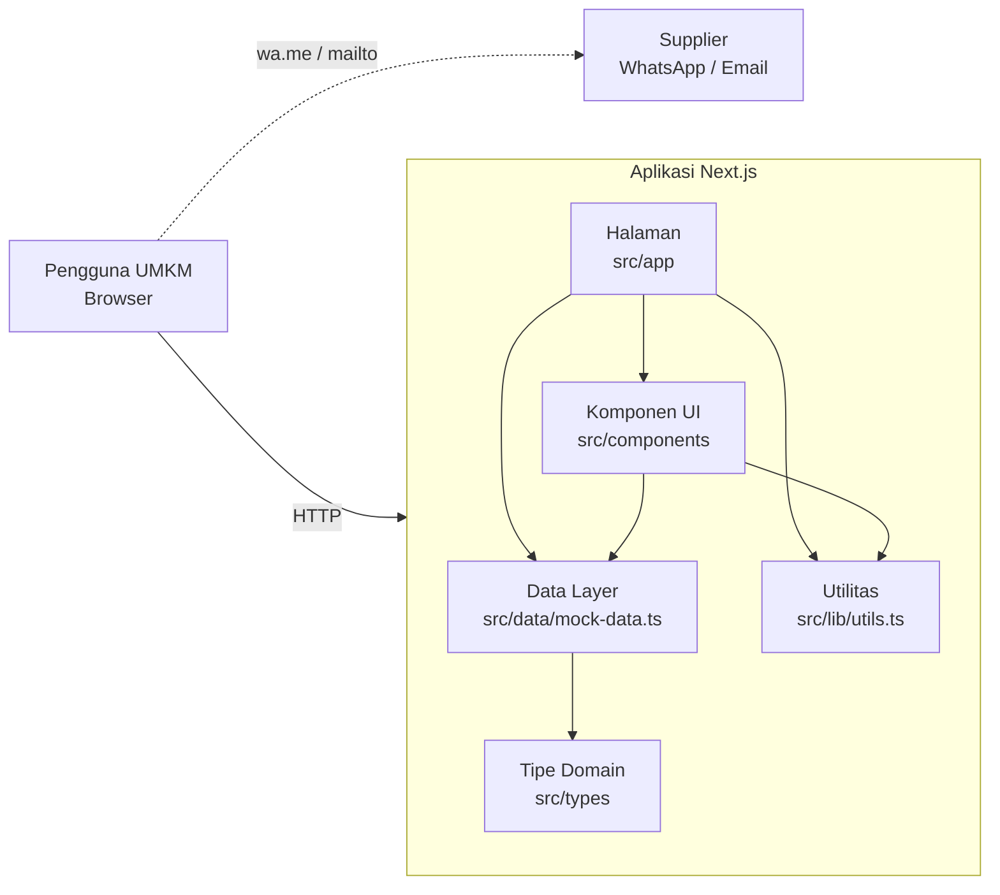
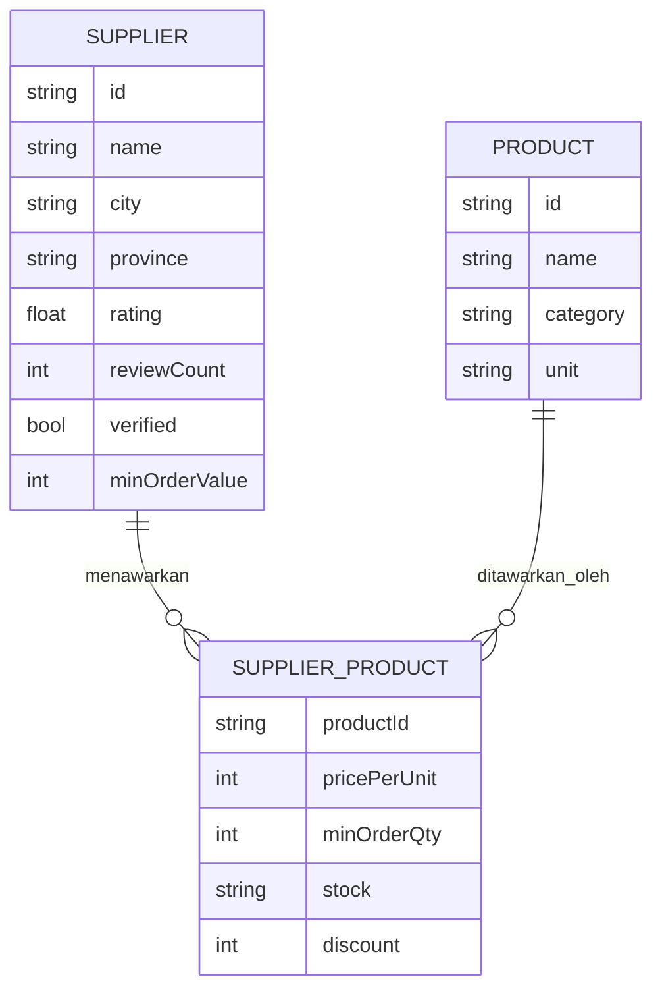
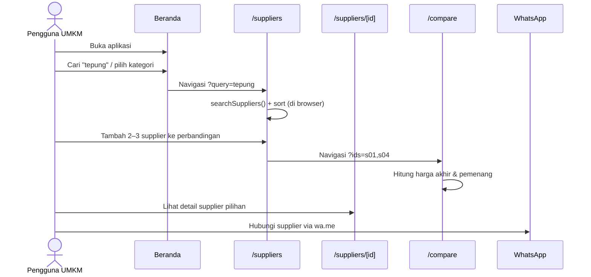
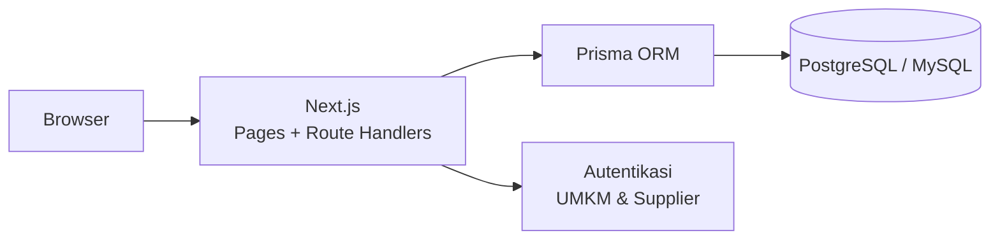

# Dokumen Arsitektur — SupplierHub

Platform pencarian dan perbandingan supplier bahan baku untuk UMKM.

## 1. Tujuan

Membantu pelaku UMKM menemukan supplier atau grosir bahan baku yang sesuai kebutuhan usaha, lalu membandingkan
beberapa supplier berdasarkan harga, minimum order, stok, lokasi, dan reputasi sebelum menghubungi supplier
langsung lewat WhatsApp atau email.

Versi pertama (v1) adalah aplikasi web **frontend-only**: semua data supplier dan produk berupa data contoh (mock data)
yang disimpan di dalam kode. Belum ada backend, database, maupun autentikasi.

## 2. Stack Teknologi

| Lapisan        | Teknologi                                   |
| -------------- | ------------------------------------------- |
| Framework      | Next.js 16 (App Router)                     |
| UI Library     | React 19                                    |
| Bahasa         | TypeScript 5                                |
| Styling        | Tailwind CSS 4 (via `@tailwindcss/postcss`) |
| Ikon           | lucide-react                                |
| Linting        | ESLint 9 + `eslint-config-next`             |
| Sumber data    | Modul TypeScript statis (`src/data/mock-data.ts`) |
| Integrasi luar | Tautan `wa.me` (WhatsApp) dan `mailto:` (email) |

## 3. Aturan Kode

* Semua label, tombol, pesan, dan teks UI menggunakan Bahasa Indonesia.
* Komponen React menggunakan PascalCase (`SupplierCard`, `SearchBar`).
* Interface dan type menggunakan PascalCase (`Supplier`, `SupplierProduct`, `SortOption`).
* Variabel lokal dan fungsi menggunakan camelCase (`searchSuppliers`, `formatRupiah`).
* Konstanta global menggunakan UPPER_SNAKE_CASE (`SUPPLIERS`, `CATEGORIES`, `MAX_COMPARE`).
* Import antar modul menggunakan alias `@/` yang mengarah ke `src/`.
* Komentar hanya ditulis jika benar-benar diperlukan.
* Komponen yang memakai state atau hook browser diberi direktif `"use client"`; selain itu tetap Server Component.

## 4. Gambaran Arsitektur



Arsitektur v1 berlapis sederhana:

1. **Presentation layer** — halaman (`src/app`) dan komponen (`src/components`).
2. **Data layer** — `src/data/mock-data.ts` berisi data statis serta fungsi query (`searchSuppliers`, `getSupplierById`, dll).
   Halaman tidak mengakses array data secara langsung untuk logika pencarian, melainkan lewat fungsi ini, sehingga
   nanti mudah diganti dengan pemanggilan API tanpa mengubah komponen.
3. **Domain types** — `src/types/index.ts` menjadi satu-satunya sumber definisi model.
4. **Utilities** — `src/lib/utils.ts` berisi format Rupiah, format angka, label/badge stok, rating bintang, dan `cn()`.

### Strategi rendering

| Rute               | Jenis                      | Keterangan                                                        |
| ------------------ | -------------------------- | ----------------------------------------------------------------- |
| `/`                | Server Component (statis)  | Landing page, dirender saat build                                 |
| `/suppliers`       | Client Component           | Pencarian, filter, dan urutan diproses di browser                 |
| `/suppliers/[id]`  | SSG (`generateStaticParams`) | Satu halaman HTML statis per supplier dibuat saat build         |
| `/compare`         | Client Component           | Daftar supplier yang dibandingkan disimpan di query string `?ids=` |

State aplikasi:

* Filter pencarian dan urutan: React state lokal di halaman `/suppliers`.
* Daftar perbandingan sementara (maks. 3): React state di `/suppliers`, ditampilkan oleh `ComparisonBar`.
* Daftar perbandingan aktif: URL (`/compare?ids=s01,s02,s03`) sehingga bisa dibagikan dan di-bookmark.
* Tidak ada state global, `localStorage`, atau penyimpanan server.

## 5. Entitas Utama

1. **Product** — katalog bahan baku umum

   * id
   * name
   * category
   * unit (kg, liter, meter, pcs, dll)
   * description

2. **Supplier** — penjual / grosir

   * id
   * name
   * logo (inisial)
   * description
   * location, city, province
   * phone, whatsapp, email
   * rating, reviewCount
   * joinedYear
   * verified
   * categories
   * shippingOptions, shippingCost
   * responseTime
   * minOrderValue
   * products: `SupplierProduct[]`

3. **SupplierProduct** — penawaran satu produk oleh satu supplier (relasi Supplier ↔ Product)

   * productId
   * pricePerUnit
   * minOrderQty
   * stock: `tersedia` | `terbatas` | `habis`
   * discount (opsional, persen)

4. **CompareItem** — pasangan `supplierId` + `productId` untuk perbandingan

Relasi:



Data contoh v1: 10 supplier, 22 produk, 8 kategori, 8 provinsi.

## 6. Aturan Bisnis

* **Pencarian** (`searchSuppliers`) mencocokkan kata kunci (tidak peka huruf besar/kecil) dengan nama supplier,
  nama produk, atau kategori produk.
* **Filter** bersifat AND: kategori, provinsi, dan harga maksimum per unit. Supplier lolos filter harga jika
  minimal satu produknya ≤ harga maksimum. Filter kosong diabaikan.
* **Urutan hasil**: rating tertinggi (default), ulasan terbanyak, minimum order terendah, minimum order tertinggi.
* **Perbandingan** maksimal 3 supplier. ID duplikat atau tidak valid di URL diabaikan.
* **Harga akhir** = `pricePerUnit × (1 − discount / 100)`.
* **Penentuan "terbaik"** di halaman perbandingan:
  * Harga terendah dan minimum order terkecil untuk produk yang dipilih (nilai minimum).
  * Rating tertinggi dan ulasan terbanyak (nilai maksimum).
  * Tidak ada pemenang jika kurang dari 2 supplier memiliki nilai, atau semua nilainya sama.
* **Produk yang dibandingkan** diurutkan dari yang dijual oleh paling banyak supplier terpilih.
* **Warna badge stok**: tersedia = hijau, terbatas = kuning/oranye, habis = merah.

## 7. Fitur dan Halaman

1. **Beranda** (`/`)

   * Hero dengan pencarian cepat dan kata kunci populer.
   * Kartu kategori bahan baku yang menuju `/suppliers?category=...`.
   * Daftar supplier unggulan.
   * Ajakan untuk mencari dan membandingkan supplier.

2. **Direktori Supplier** (`/suppliers`)

   * `SearchBar` dengan kata kunci, kategori, provinsi, dan harga maksimum.
   * Menerima parameter awal `?query=` dan `?category=` dari halaman lain.
   * Pilihan urutan dan tampilan kisi / daftar.
   * `SupplierCard` dengan tombol detail, WhatsApp, dan tambah ke perbandingan.
   * `ComparisonBar` melayang di bawah layar saat ada supplier yang dipilih.
   * Empty state jika tidak ada hasil, dengan tombol reset pencarian.

3. **Detail Supplier** (`/suppliers/[id]`)

   * Profil, lokasi, rating, status terverifikasi, waktu respons.
   * Tabel produk dengan harga, diskon, minimum order, dan stok.
   * Opsi dan biaya pengiriman.
   * Tombol hubungi via WhatsApp (pesan otomatis), email permintaan penawaran, dan bandingkan.

4. **Perbandingan Supplier** (`/compare`)

   * Tabel berdampingan hingga 3 supplier.
   * Pemilih produk untuk membandingkan harga, minimum order, dan stok produk yang sama.
   * Ringkasan pemenang per kriteria.
   * Dialog untuk menambah supplier, tombol hapus per kolom.
   * Empty state jika belum ada supplier yang dipilih.

## 8. Alur Pengguna Utama



## 9. Struktur Folder

```text
Rpl-app/
  public/                       aset statis
  src/
    app/
      layout.tsx                layout root (Header, Footer, font, metadata)
      globals.css               design token & Tailwind
      page.tsx                  Beranda
      suppliers/
        page.tsx                Direktori + pencarian
        [id]/page.tsx           Detail supplier (SSG)
      compare/
        page.tsx                Perbandingan supplier
    components/
      layout/
        Header.tsx              navigasi + menu mobile
        Footer.tsx
      search/
        SearchBar.tsx           form kata kunci & filter
      supplier/
        SupplierCard.tsx        kartu ringkas supplier
        ComparisonBar.tsx       bar daftar perbandingan
    data/
      mock-data.ts              data contoh + fungsi query
    lib/
      utils.ts                  helper format & styling
    types/
      index.ts                  model domain
  next.config.ts
  tsconfig.json
  eslint.config.mjs
  postcss.config.mjs
  package.json
```

## 10. Kebutuhan UI

* Seluruh teks dalam Bahasa Indonesia, mata uang dalam format Rupiah (`Intl.NumberFormat("id-ID")`).
* Responsif untuk mobile, tablet, dan desktop; menu navigasi mobile pada `Header`.
* Warna, permukaan, dan teks memakai design token di `globals.css` (`ink`, `surface`, `accent`, `line`, dll).
* Aksesibilitas dasar: label untuk input, `aria-label` pada tombol ikon, `aria-live` pada jumlah hasil,
  `aria-pressed` pada tombol toggle, dialog native `<dialog>`.
* Komponen sederhana: kartu, tabel, badge, form, empty state.
* Tanpa grafik pada versi pertama.

## 11. Menjalankan Aplikasi

```bash
npm install
npm run dev      # http://localhost:3000
npm run build    # build produksi (termasuk SSG halaman detail)
npm run start
npm run lint
```

## 12. Batasan Versi 1

* Data statis: perubahan data supplier memerlukan perubahan kode dan build ulang.
* Tidak ada akun pengguna, login supplier, atau panel admin.
* Tidak ada transaksi / pemesanan di dalam aplikasi; transaksi terjadi di luar lewat WhatsApp atau email.
* Rating dan ulasan bersifat data contoh, belum dapat diisi pengguna.

## 13. Rencana Pengembangan (v2)

Arsitektur target jika aplikasi dikembangkan menjadi full-stack. Bagian ini **belum diimplementasikan**.



* Ganti `src/data/mock-data.ts` dengan **Route Handlers** Next.js (`src/app/api/.../route.ts`) yang membaca database.
  Karena halaman sudah memakai fungsi query, perubahan cukup di data layer.
* Tabel database mengikuti entitas di bagian 5; `SupplierProduct` menjadi tabel relasi dengan
  unique key (`supplierId`, `productId`).
* Rencana endpoint REST:
  * `GET /api/suppliers?query=&category=&province=&maxPrice=&sort=`
  * `GET /api/suppliers/:id`
  * `GET /api/products`
  * `GET /api/categories`
  * `GET /api/compare?ids=s01,s02,s03`
  * `POST /api/suppliers`, `PUT /api/suppliers/:id`, `DELETE /api/suppliers/:id` (khusus admin / supplier)
  * `POST /api/suppliers/:id/reviews`
* Fitur lanjutan: login supplier untuk mengelola produk dan stok, ulasan dari UMKM, simpan supplier favorit,
  dan permintaan penawaran (RFQ) di dalam aplikasi.
