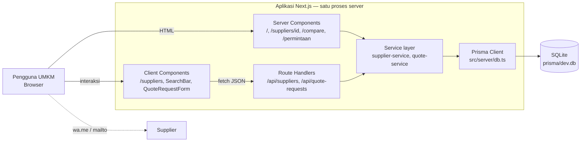
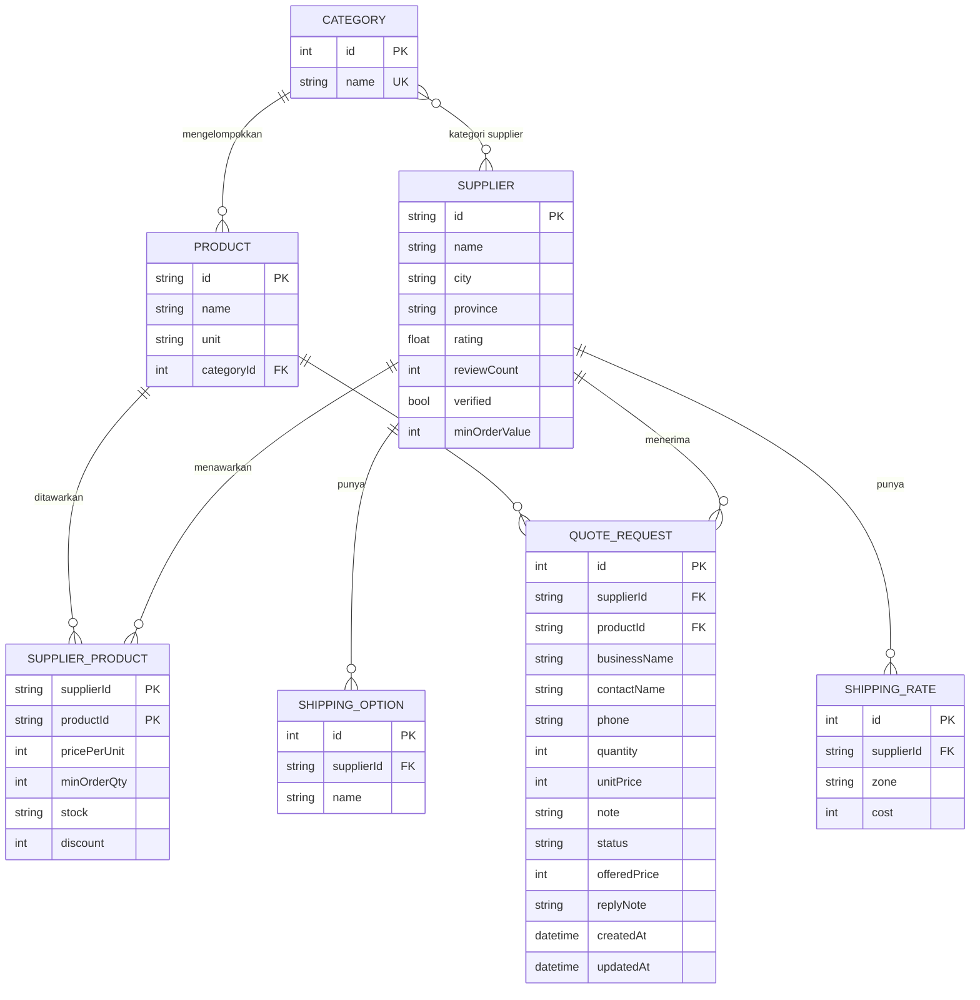
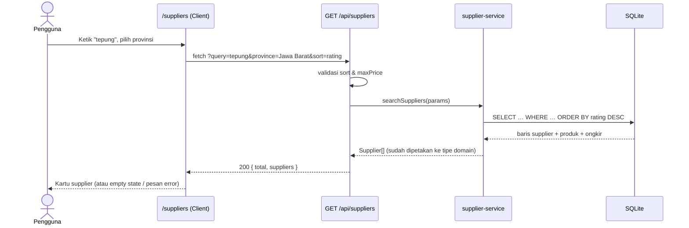
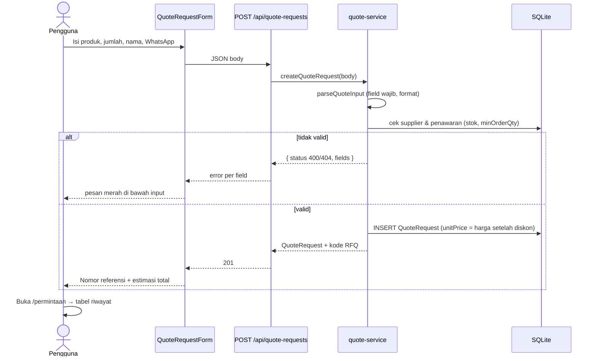

# Dokumen Arsitektur — SupplierHub (MVP v1)

Platform pencarian, perbandingan, dan permintaan penawaran supplier bahan baku untuk UMKM.

## 1. Tujuan

Membantu pelaku UMKM menemukan supplier atau grosir bahan baku yang sesuai kebutuhan usaha, membandingkan
beberapa supplier berdasarkan harga, minimum order, stok, lokasi, dan reputasi, lalu mengirim permintaan
penawaran harga (RFQ) yang tersimpan di sistem.

MVP v1 adalah aplikasi **full-stack dalam satu proyek Next.js**: halaman UI dan REST API berjalan di server
yang sama, data disimpan di database SQLite lewat Prisma. Belum ada autentikasi; diasumsikan satu pengguna.

## 2. Stack Teknologi

| Lapisan        | Teknologi                                                   |
| -------------- | ----------------------------------------------------------- |
| Framework      | Next.js 16 (App Router)                                     |
| UI             | React 19, Tailwind CSS 4, lucide-react                      |
| Bahasa         | TypeScript 5                                                |
| API            | REST, Next.js Route Handlers (`src/app/api/**/route.ts`)    |
| ORM            | Prisma 7 (`prisma-client` generator + driver adapter)       |
| Database       | SQLite (`prisma/dev.db`) via `@prisma/adapter-better-sqlite3` |
| Testing        | Vitest (acceptance test terhadap database test terpisah)    |
| Integrasi luar | Tautan `wa.me` (WhatsApp) dan `mailto:`                     |

Alasan memilih SQLite: lingkungan pengembangan tidak memiliki Docker, dan SQLite cukup untuk MVP satu pengguna.
Karena akses data lewat Prisma, pindah ke PostgreSQL/MySQL cukup mengganti `provider` dan driver adapter.

## 3. Aturan Kode

* Semua label, tombol, pesan error, dan validasi menggunakan Bahasa Indonesia.
* PascalCase untuk komponen React, interface, dan type; camelCase untuk variabel dan fungsi;
  UPPER_SNAKE_CASE untuk konstanta global.
* Import memakai alias `@/` → `src/`.
* Tipe domain hanya didefinisikan sekali di `src/types/index.ts`. Frontend **tidak** mengimpor tipe Prisma.
* Service di `src/server/` memetakan baris Prisma ke tipe domain sebelum dikirim ke UI atau API.
* `"use client"` hanya untuk komponen yang butuh state/interaksi browser.
* Komentar hanya jika benar-benar perlu.

## 4. Gambaran Arsitektur



Lapisan:

1. **Presentation** — `src/app/**/page.tsx` dan `src/components/**`.
   * Server Component memanggil service secara langsung (tanpa HTTP) dan dirender per request (`await connection()`),
     sehingga tampilan selalu sesuai isi database.
   * Client Component memanggil REST API lewat `src/lib/api.ts`.
2. **API** — `src/app/api/**/route.ts`. Membaca parameter/body, memvalidasi, memanggil service,
   dan mengembalikan JSON dengan status HTTP yang sesuai (200/201/400/404).
3. **Service** — `src/server/supplier-service.ts`, `src/server/quote-service.ts`. Berisi query, aturan bisnis,
   dan mapping Prisma → tipe domain. Dipakai bersama oleh Server Component dan Route Handler.
4. **Data access** — `src/server/db.ts` membuat satu instance PrismaClient (disimpan di `globalThis` saat dev).
5. **Database** — skema di `prisma/schema.prisma`, riwayat perubahan di `prisma/migrations/`, data contoh di `prisma/seed.ts`.

### Strategi rendering

| Rute               | Jenis                         | Sumber data                                  |
| ------------------ | ----------------------------- | -------------------------------------------- |
| `/`                | Server Component, dinamis     | `searchSuppliers()`, `getProducts()`         |
| `/suppliers`       | Client Component              | `GET /api/suppliers` (setiap filter/sort berubah) |
| `/suppliers/[id]`  | Server Component, dinamis     | `getSupplierById()`; form RFQ → `POST /api/quote-requests` |
| `/compare`         | Server (data) + Client (interaksi) | `searchSuppliers()` → props `CompareClient`; pilihan di URL `?ids=` |
| `/permintaan`      | Server Component, dinamis     | `listQuoteRequests()`; filter lewat `?supplier=` |

## 5. Model Data



Catatan desain:

* `SupplierProduct` adalah tabel relasi Supplier ↔ Product dengan primary key gabungan (`supplierId`, `productId`):
  satu supplier hanya punya satu penawaran per produk.
* Daftar kategori, opsi kirim, dan ongkir per zona dinormalisasi ke tabel sendiri karena SQLite tidak punya tipe array.
* `QuoteRequest.unitPrice` adalah **snapshot** harga setelah diskon saat permintaan dibuat,
  supaya estimasi total tidak berubah jika supplier mengubah harga.
* `stock` bernilai `tersedia` | `terbatas` | `habis`; `status` RFQ: `BARU` | `DIBALAS` | `DITERIMA` | `DITOLAK` | `DIBATALKAN`.
* `QuoteRequest.offeredPrice` dan `replyNote` diisi saat supplier membalas.

Data contoh (seed): 8 kategori, 22 produk, 10 supplier.

## 6. REST API

| Method | Endpoint | Keterangan | Respons |
| ------ | -------- | ---------- | ------- |
| GET | `/api/suppliers?query=&category=&province=&maxPrice=&sort=` | Cari & filter supplier | 200 `{ total, suppliers }`, 400 parameter tidak valid |
| GET | `/api/suppliers/:id` | Detail supplier + produk | 200 `Supplier`, 404 |
| POST | `/api/quote-requests` | Buat permintaan penawaran | 201 `QuoteRequest`, 400 `{ error, fields }`, 404 supplier tidak ada |
| GET | `/api/quote-requests?supplierId=&status=` | Daftar permintaan, terbaru di atas | 200 `{ total, quotes }`, 400 status tidak dikenal |
| GET | `/api/quote-requests/:id` | Detail permintaan | 200 `QuoteRequest`, 404 |
| PATCH | `/api/quote-requests/:id` | Ubah status `{ status, offeredPrice?, replyNote? }` | 200, 400 data tidak valid, 404, 409 perpindahan status terlarang |

`sort`: `rating` (default) | `review` | `price_asc` | `price_desc` (berdasarkan minimum order supplier).

Contoh body `POST /api/quote-requests`:

```json
{
  "supplierId": "s10",
  "productId": "p01",
  "businessName": "Roti Bu Sari",
  "contactName": "Sari Wulandari",
  "phone": "081234567890",
  "quantity": 150,
  "note": "Kirim minggu depan"
}
```

## 7. Aturan Bisnis

**Pencarian (Fitur 1)**

* Kata kunci dicocokkan (tidak peka huruf besar/kecil) ke nama supplier, nama produk, atau kategori produk.
* Filter digabung dengan AND: kategori supplier, provinsi, dan harga maksimum per unit
  (lolos jika minimal satu produk ≤ harga maksimum). Filter kosong diabaikan.
* Semua filter dan urutan dikerjakan database (klausa `WHERE`/`ORDER BY` dari Prisma), bukan di browser.

**Perbandingan**

* Maksimal 3 supplier; ID duplikat atau tidak valid di URL diabaikan.
* Harga akhir = `pricePerUnit × (1 − discount/100)`.
* "Terbaik" per kriteria hanya ditandai jika minimal 2 supplier punya nilai dan nilainya tidak sama semua.

**Permintaan penawaran (Fitur 2)** — semua divalidasi di server:

| Aturan | Pesan |
| ------ | ----- |
| Produk wajib dipilih | "Pilih produk yang ingin ditanyakan." |
| Nama usaha & nama kontak 2–100 karakter | "Nama usaha wajib diisi (minimal 2 karakter)." |
| Nomor WhatsApp format Indonesia (`08…`, `628…`, `+628…`, spasi/strip dibuang) | "Nomor WhatsApp tidak valid. Contoh: 081234567890." |
| Jumlah bilangan bulat > 0 | "Jumlah harus bilangan bulat lebih dari 0." |
| Produk harus dijual supplier tersebut | "Produk ini tidak dijual oleh supplier tersebut." |
| Stok tidak boleh habis | "Stok … sedang habis." |
| Jumlah ≥ minimum order produk | "Minimum order … adalah … kg." |
| Catatan maks. 500 karakter | "Catatan maksimal 500 karakter." |

Nomor referensi: `RFQ-` + id 5 digit (contoh `RFQ-00001`). Estimasi total = `unitPrice × quantity`.

**Estimasi biaya (US3)** — `src/lib/cost-estimate.ts`

* Total = harga setelah diskon × jumlah + ongkir zona (tanpa zona = ambil sendiri, tanpa ongkir).
* Peringatan bila: jumlah < minimum order produk, subtotal < minimum belanja supplier, zona tidak dilayani, stok habis.

**Status RFQ (US5)** — `src/lib/quote-status.ts`

```text
BARU ──balas (harga wajib)──▶ DIBALAS ──▶ DITERIMA | DITOLAK
BARU / DIBALAS ──────────────▶ DIBATALKAN
```

`DITERIMA`, `DITOLAK`, `DIBATALKAN` adalah status akhir. Perpindahan lain ditolak 409.
Update memakai `WHERE id AND status = <status lama>` agar dua perubahan bersamaan tidak saling menimpa.

## 8. Alur Data

### Fitur 1 — mencari supplier



### Fitur 2 — mengirim permintaan penawaran



## 9. Struktur Folder

```text
Rpl-app/
  prisma/
    schema.prisma               model database
    migrations/                 riwayat migrasi SQL
    seed.ts                     isi data contoh
    seed-data.ts                data contoh (dulu src/data/mock-data.ts)
  prisma.config.ts              konfigurasi Prisma CLI (lokasi skema, migrasi, seed, DATABASE_URL)
  src/
    app/
      api/
        suppliers/route.ts            GET daftar supplier
        suppliers/[id]/route.ts       GET detail supplier
        quote-requests/route.ts       GET & POST permintaan penawaran
      page.tsx                  Beranda
      suppliers/page.tsx        Direktori + pencarian (client)
      suppliers/[id]/page.tsx   Detail supplier + form RFQ
      compare/page.tsx          Ambil data (server)
      compare/CompareClient.tsx Tabel perbandingan (client)
      permintaan/page.tsx       Riwayat permintaan penawaran
    components/
      layout/                   Header, Footer
      search/SearchBar.tsx
      supplier/                 SupplierCard, ComparisonBar, QuoteRequestForm
    server/                     hanya berjalan di server
      db.ts                     PrismaClient
      supplier-service.ts
      quote-service.ts
    lib/
      api.ts                    fetcher untuk client component
      constants.ts              daftar kategori & provinsi
      utils.ts                  format Rupiah, badge stok, dll
    types/index.ts              tipe domain & DTO API
    generated/prisma/           Prisma Client hasil generate (tidak di-commit)
  tests/                        acceptance test Vitest
  docs/
    LAPORAN-P5.md
    evidence/                   log verifikasi API
```

## 10. Kebutuhan UI

* Bahasa Indonesia, format Rupiah `Intl.NumberFormat("id-ID")`, tanggal zona Asia/Jakarta.
* Responsif (mobile–desktop), menu mobile di `Header`.
* State yang ditangani: loading (skeleton), error (pesan + tombol coba lagi), empty state, sukses.
* Form: label untuk setiap input, `aria-invalid` + `aria-describedby` untuk pesan error.
* Badge stok: tersedia hijau, terbatas kuning, habis merah. Tanpa grafik di versi pertama.

## 11. Batasan MVP v1

* Belum ada login (UMKM/supplier/admin); halaman `/permintaan` menampilkan semua permintaan.
* Belum ada login, jadi aksi supplier (balas) dan UMKM (terima/tolak/batal) ada di halaman yang sama.
* Data supplier dan produk hanya bisa diubah lewat seed / Prisma Studio.
* SQLite cocok untuk satu server; untuk produksi multi-instance gunakan PostgreSQL.

## 12. Rencana Pengembangan

* Autentikasi UMKM dan supplier; supplier mengelola produk, stok, dan membalas RFQ (status `DIBALAS`, `DITUTUP`).
* CRUD supplier/produk untuk admin.
* Ulasan dan rating dari UMKM.
* Pindah ke PostgreSQL dan deploy.
